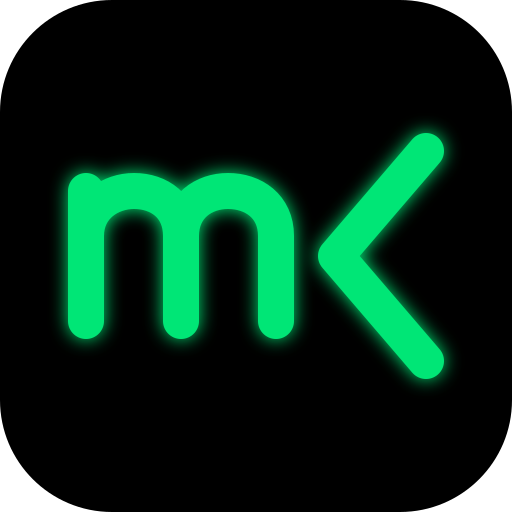

<div align="center">
  
  <h1>MacroCode</h1>
  <p><strong>An AI terminal you control — bring your own key, keep your own data.</strong></p>
  <p>
    <a href="https://github.com/Geblkc/MacroCode/releases"></a>
    
    
    <a href="LICENSE"></a>
  </p>
  <p><strong>English</strong> · <a href="README.tr.md">Türkçe</a> · <a href="README.de.md">Deutsch</a> · <a href="README.fr.md">Français</a> · <a href="README.ru.md">Русский</a></p>
</div>


## What is MacroCode?

MacroCode is an open-source, cross-platform desktop application that allows you to chat and work with AI models using your own API keys. ** (BYOK).
It is built with Tauri v2 + React + TypeScript, ships as a single small native binary,
and is designed for developers who like text, commands and keyboard-first tools.

There is no server, no account and no telemetry: your conversations are stored in a
local SQLite database, and your keys never leave your machine except as
authentication headers sent directly to the provider you configured.

## What can it do?

| | |
|---|---|
| 🧠 **12 providers** | Anthropic, OpenAI, Google Gemini, Ollama, OpenRouter, DeepSeek, xAI, MiniMax, Kimi (Moonshot AI), GLM (Zhipu AI), NVIDIA and EVREN LLM. Each provider only appears in the lists once its key (or, for Ollama, a local URL) is set. |
| 🔮 **Hundreds of models** | Live model lists from each provider API (with your key), enriched with [models.dev](https://models.dev) metadata for context limits, vision/reasoning and pricing. Falls back to the built-in catalog when an API list is unavailable. |
| ⌨️ **Terminal-native UX** | Slash commands (`/model`, `/tokens`, `/compact`, `/help`…), message history with `↑ ↓`, instant token metering for every turn. |
| 🤖 **Agent mode** | Point it at a project folder with `/root` and it can read files, search the codebase, edit files and run shell commands. Every write/execution goes through an approval card you can accept or reject; `rm` is restricted and system folders are blocked. It also connects to MCP servers (stdio or HTTP) for extra tools. |
| ⏱️ **Project snapshots** | Take a restore point of the whole project with `/snapshot` (or the Titlebar workspace menu), list them with `/snapshots`, and roll back with `/restore <id>`. Secrets and ignored dirs are excluded, and a safety snapshot is created before every restore. |
| 🔀 **Git built in** | A docked Git panel and `/git` commands: status, diff, staged/unstaged files, commit (with optional AI message), history, branches and fetch/pull (fast-forward only)/push. Mutations ask for confirmation; the app never stores credentials or force-pushes. |
| 💸 **Cost control** | Prompt caching (Anthropic cache breakpoints / OpenAI-compatible cache keys) keeps long sessions cheap, and `/tokens` shows exactly what each turn cost, including cache reads. |
| 🌍 **5 languages** | Fully translated UI: English, Türkçe, Deutsch, Français and Español — switching applies instantly, no restart. |
| 🔒 **Your data, always** | Sessions live in SQLite with JSON export/import, so everything is portable and works offline when you need it to. |

## Installation

Download the package for your platform from the
[Releases](https://github.com/Geblkc/MacroCode/releases) page
(Linux `.deb` / `.rpm` / `.AppImage`, Windows `.msi` / `.exe`, macOS `.dmg`).

> Windows and macOS builds are Authenticode/Developer ID signed **when the
> release signing secrets are configured**. If a build is unsigned, Windows
> SmartScreen and macOS Gatekeeper may warn about an unidentified publisher.

Or build from source:

```bash
npm install
npm run tauri dev    # full desktop app (Rust + Tauri toolchain required)
npm test             # unit tests
```

Production bundles:

```bash
npm run dist:linux   # .deb / .rpm / AppImage
npm run build        # type-check + web build only
```

## First run

1. Open **Settings** (or type `/key`).
2. Paste an API key for your provider and save. For [Ollama](https://ollama.com),
   a local URL like `http://localhost:11434` is enough.
3. Type a message — or `/help` to see all commands.

## Documentation

- [`docs/ARCHITECTURE.md`](docs/ARCHITECTURE.md) — how the project is structured, module by module
- [`docs/MODELS.md`](docs/MODELS.md) — the live API catalog, fallback rules and models.dev metadata merge
- [`docs/PACKAGING.md`](docs/PACKAGING.md) — building `.deb` / `.rpm` / AppImage locally and Windows/macOS installers via CI
- [`docs/DEVLOG.md`](docs/DEVLOG.md) — dated record of every change
- [`CONTRIBUTING.md`](CONTRIBUTING.md) — guidelines for pull requests

## Contributing

Contributions are welcome — bug reports, translations and pull requests alike.
See [`CONTRIBUTING.md`](CONTRIBUTING.md) for the workflow, and please open an issue
before starting large changes.

## License

MacroCode is licensed under the **GNU General Public License v2.0 only**
(`GPL-2.0-only`) — see [`LICENSE`](LICENSE) for the full text.

```
Copyright (C) 2026 Gökhan Efe Balıkçı
```
